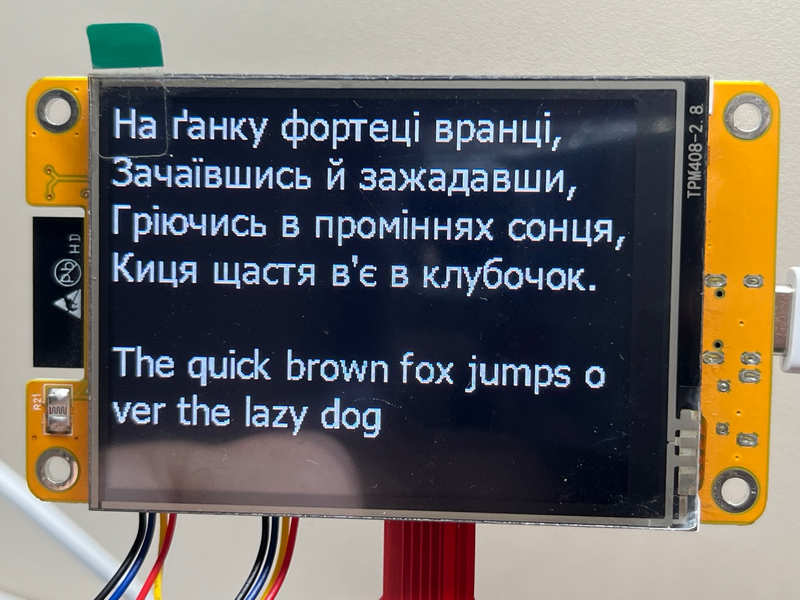
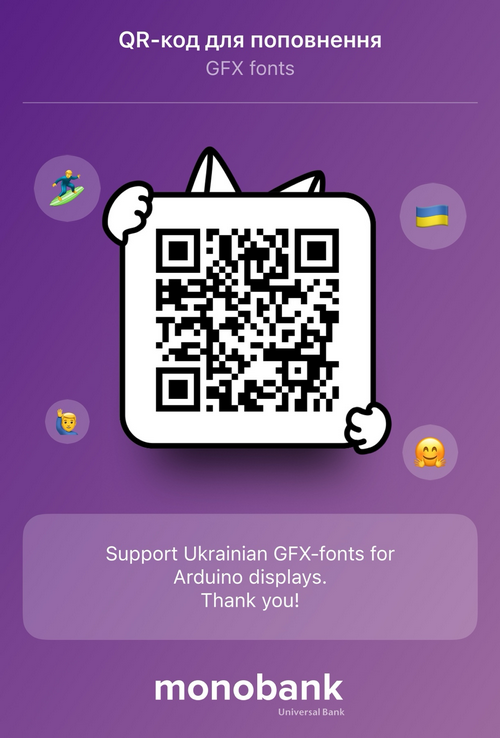

# Ukr_GFX_fonts

---

## 🇬🇧 English

**Ukr_GFX_fonts** is a collection of fonts with Ukrainian character support for GFX libraries (Adafruit GFX, Arduino_GFX, LovyanGFX, TFT_eSPI) and a helper function to convert UTF-8 strings with Ukrainian letters into font codes.

### Library Compatibility

| Library                           | Compatibility | Notes                              |
|----------------------------------|---------------|------------------------------------|
| Adafruit GFX                      | ✅ Full       | Original format                    |
| Arduino_GFX_Library               | ✅ Full       | Recommended                        |
| LovyanGFX                         | ✅ Full       | Via `setFont(const GFXfont*)`     |
| TFT_eSPI                          | ⚙️ Partial    | Via `setFreeFont()`                |
| GxEPD / GxEPD2                     | ✅ Full       | E-Ink displays                      |
| Adafruit_ST7735, ILI9341, SSD1306 | ✅ Full       | Subset of GFX                      |

### Installation (PlatformIO)

Add the library to your `platformio.ini` file:

```ini
lib_deps =
    igor-gia/Ukr_GFX_fonts
    ; or directly from GitHub:
    ; [https://github.com/igor-gia/Ukr_GFX_fonts.git](https://github.com/igor-gia/Ukr_GFX_fonts.git)
```

### Library Contents

- **Fonts** (`.h` files are in `src/fonts/`)

| Serif        | Sans-Serif     | Monospace    |
|-------------|----------------|--------------|
| Cambria     | Constant       | Consola      |
|             | Segoe UI       | Lucon        |
|             | Tahoma         | Micross      |
|             | Verdana        |              |

> **Note 1:** Suffixes `i`, `b`, or `z` in a font file name indicate **italic**, **bold**, or **italic bold** style.  
> **Note 2:** The number in the font file name indicates the **font size**.  
> **Note 3:** At small font sizes, minor visual artifacts may appear. You can adjust fonts using online tools like the [Adafruit GFX Pixel Font Customiser](https://tchapi.github.io/Adafruit-GFX-Font-Customiser/).

- **Conversion function**  
  - `String Utf8win1251(const char* source)` — converts a UTF-8 string into font codes (safely skipping 3- and 4-byte UTF-8 sequences like emojis or special symbols).
  - Used to display Ukrainian and Cyrillic letters via GFX.

⚠️ **Important:** The **LovyanGFX** library uses an internal string re-encoding algorithm. For the function to work correctly, you must explicitly disable it in `setup()`
```cpp
lcd.setAttribute(lgfx::attribute::utf8_switch, false);
```

### Usage

Example of including the library and font

```cpp
#include <Arduino_GFX_Library.h>
#include <utils.h>
#include <fonts/tahomaUkr12.h> // desired font
```

Example of printing Ukrainian text

```cpp
String msg = "Привіт Ґ!";
gfx->setFont(&tahomaUkr12);
gfx->setCursor(0, 20);
gfx->print(Utf8win1251(msg.c_str()));
```

### Demo Sketches

The `examples/` folder contains two ready-to-use examples for different graphics engines:
- `examples/ArduinoGFX_Test/ArduinoGFX_Test.ino` — demo for **Arduino_GFX** (configured for ESP32 Cheap Yellow Display).
- `examples/LovyanGFX_Test/LovyanGFX_Test.ino` — demo for **LovyanGFX** (configured for ESP32-S2 Mini + ST7735).

Below is a screenshot of the demo running on an **ESP32 Cheap Yellow Display**



*Screenshot of the demo running on an ESP32 Cheap Yellow Display.*

### Support

If you find this project useful and want to support its development, you can donate via one of the following ways

- **PayPal**: `gia@gia.org.ua` — [Donate via PayPal](https://www.paypal.me)  
- **Ko-fi**: [Donate on Ko-fi](https://ko-fi.com/igorgimelfarb)  
- **Monobank**: Scan the QR code or use the link: [Donate via Monobank](https://send.monobank.ua/jar/8d9QXHvrNa)



**Your support is greatly appreciated!**

### License

MIT License — free to use, modify, and distribute. See `LICENSE` for details.  

---

## 🇺🇦 Українська

**Ukr_GFX_fonts** — це колекція шрифтів з підтримкою українських букв для бібліотек GFX (Adafruit GFX, Arduino_GFX, LovyanGFX, TFT_eSPI) та допоміжна функція для перетворення UTF-8 рядків з українськими символами у коди шрифтів.

### Сумісність з бібліотеками

| Бібліотека                        | Сумісність    | Примітка                            |
| --------------------------------- | ------------- | ---------------------------------- |
| Adafruit GFX                      | ✅ Повна      | Оригінальний формат                |
| Arduino_GFX_Library               | ✅ Повна      | Рекомендована                      |
| LovyanGFX                         | ✅ Повна      | Через `setFont(const GFXfont*)`   |
| TFT_eSPI                          | ⚙️ Часткова   | Через `setFreeFont()`              |
| GxEPD / GxEPD2                     | ✅ Повна      | E-Ink дисплеї                      |
| Adafruit_ST7735, ILI9341, SSD1306 | ✅ Повна      | Підмножина GFX                     |

### Встановлення (PlatformIO)

Додайте бібліотеку до вашого файлу `platformio.ini`:

```ini
lib_deps =
    igor-gia/Ukr_GFX_fonts
    ; або напряму з GitHub:
    ; [https://github.com/igor-gia/Ukr_GFX_fonts.git](https://github.com/igor-gia/Ukr_GFX_fonts.git)
```

### Вміст бібліотеки

- **Шрифти** (файли `.h` знаходяться в `src/fonts/`)

| З засічками (Serif) | Без засічок (Sans-Serif) | Моноширинні (Monospace) |
|--------------------|--------------------------|-------------------------|
| Cambria            | Constant                 | Consola                 |
|                    | Segoe UI                 | Lucon                   |
|                    | Tahoma                   | Micross                 |
|                    | Verdana                  |                         |

> **Примітка 1:** Суфікси `i`, `b` або `z` у назві файлу шрифту означають **italic**, **bold** або **italic bold** стиль.  
> **Примітка 2:** Цифра в назві файлу шрифту означає **розмір шрифту**.  
> **Примітка 3:** На малих розмірах шрифтів можуть з’являтися невеликі артефакти. Ви можете підправити шрифти на свій смак, використовуючи онлайн-інструменти, такі як [Adafruit GFX Pixel Font Customiser](https://tchapi.github.io/Adafruit-GFX-Font-Customiser/).

- **Функція перетворення**  
  - `String Utf8win1251(const char* source)` — перетворює UTF-8 рядок у коди шрифта (безпечно пропускаючи 3- та 4-байтові UTF-8 символи, такі як емодзі чи спецзнаки).
  - Використовується для відображення українських символів через GFX.

⚠️ **Важливо:** Бібліотека **LovyanGFX** використовує внутрішній алгоритм перекодування рядків. Щоб функція працювала коректно, необхідно явно вимкнути його у `setup()`
```cpp
lcd.setAttribute(lgfx::attribute::utf8_switch, false);
```

### Підключення

Приклад підключення бібліотеки та шрифту

```cpp
#include <Arduino_GFX_Library.h>
#include <utils.h>
#include <fonts/tahomaUkr12.h> // потрібний шрифт
```

### Використання

Приклад виклику функції `Utf8win1251` для виводу тексту на дисплей

```cpp
String msg = "Привіт Ґ!";
gfx->setFont(&tahomaUkr12);
gfx->setCursor(0, 20);
gfx->print(Utf8win1251(msg.c_str()));
```

### Приклади (Demo Sketches)

У папці `examples/` містяться два готові приклади для різних графічних бібліотек:
- `examples/ArduinoGFX_Test/ArduinoGFX_Test.ino` — приклад для **Arduino_GFX** (налаштований під ESP32 Cheap Yellow Display).
- `examples/LovyanGFX_Test/LovyanGFX_Test.ino` — приклад для **LovyanGFX** (налаштований під ESP32-S2 Mini + ST7735).

Нижче наведено скріншот роботи скетчу на **ESP32 Cheap Yellow Display**


*Скріншот роботи прикладу на ESP32 Cheap Yellow Display.*

### Підтримка

Якщо ви вважаєте цей проект корисним і хочете підтримати його розробку, ви можете зробити пожертву будь-яким із наступних способів

- **PayPal**: `gia@gia.org.ua` — [Donate via PayPal](https://www.paypal.me)  
- **Ko-fi**: [Donate on Ko-fi](https://ko-fi.com/igorgimelfarb)  
- **Monobank**: Відскануйте QR-код або скористайтеся посиланням: [Пожертвувати через Monobank](https://send.monobank.ua/jar/8d9QXHvrNa)


**Ваша підтримка буде дуже цінною!**

### Ліцензія

MIT License — вільне використання, модифікація та розповсюдження. Детальніше у файлі `LICENSE`.

## Keywords

Ukrainian, Cyrillic, GFX, Adafruit, Arduino, fonts, UTF-8, display, text, Tahoma, Cambria, Constant, Segoe UI, Verdana, Consola, Lucon, Micross, Adafruit GFX, Arduino_GFX_Library, TFT_eSPI, LovyanGFX, GxEPD, E-Ink, embedded, microcontroller, ESP32, OLED, LCD, text rendering, pixel font